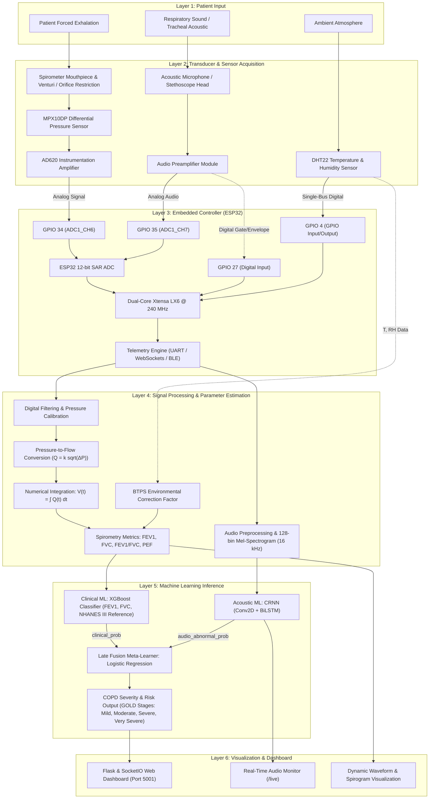
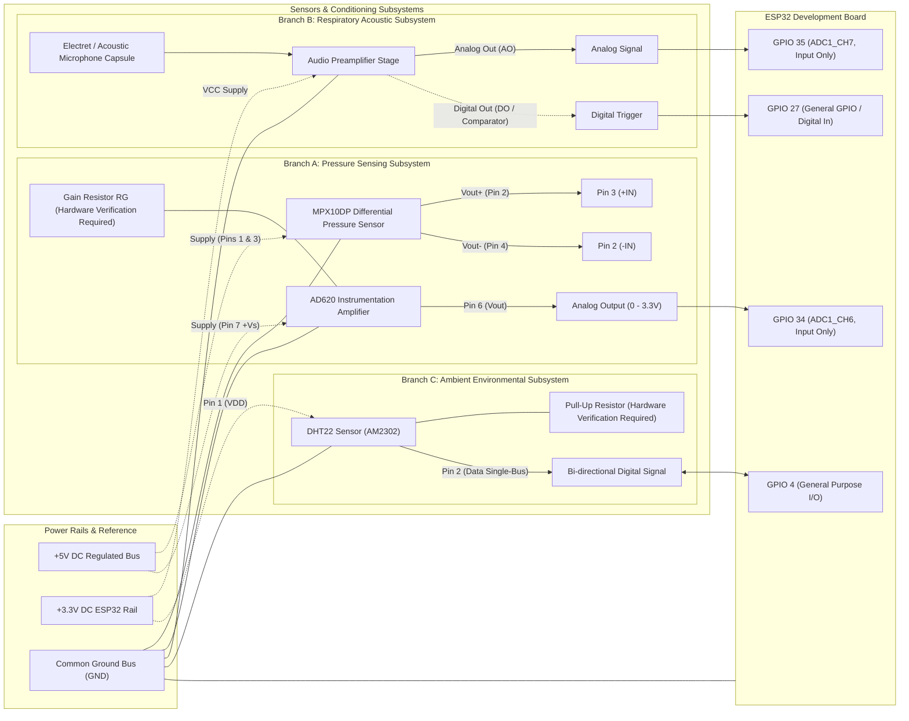
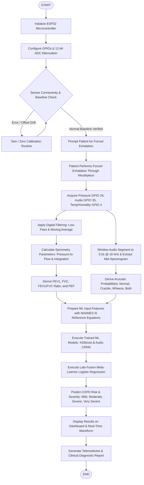
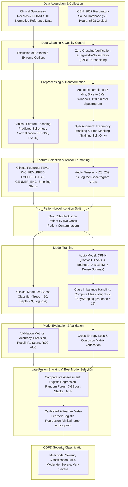

# System Architecture: AI-Powered COPD Severity Prediction and Respiratory Monitoring System Using ESP32

## Executive Architectural Summary

This document provides a comprehensive technical breakdown of the complete hardware, firmware, signal processing, and machine learning architecture for the **AI-Powered COPD Severity Prediction and Respiratory Monitoring System Using ESP32**.

The system integrates biomedical instrumentation, edge embedded computing, real-time digital signal processing, and late-fusion machine learning to achieve non-invasive Chronic Obstructive Pulmonary Disease (COPD) screening and severity categorization.

---

## Complete Multi-Layer Architecture

The system is organized into six functional layers:

1. **Layer 1: Patient Input**
2. **Layer 2: Transducer and Sensor Acquisition**
3. **Layer 3: ESP32 Edge Data Acquisition**
4. **Layer 4: Signal Processing and Parameter Estimation**
5. **Layer 5: Machine Learning Inference Pipeline**
6. **Layer 6: Output, Telemetry, and Clinical Visualization**

```
+---------------------------------------------------------------------------------------------------+
|                                     LAYER 1: PATIENT INPUT                                        |
|                     Forced Exhalation Maneuver  |  Tracheal / Auscultation Acoustic Sounds        |
+---------------------------------------------------------------------------------------------------+
                                                  |
                                                  v
+---------------------------------------------------------------------------------------------------+
|                                LAYER 2: TRANSDUCER & SENSING                                      |
|   Branch A: MPX10DP + AD620  |  Branch B: Acoustic Mic + Preamp  |  Branch C: DHT22 Temp/Humidity |
+---------------------------------------------------------------------------------------------------+
                                                  |
                                                  v
+---------------------------------------------------------------------------------------------------+
|                                 LAYER 3: ESP32 EMBEDDED EDGE                                      |
|        12-Bit SAR ADC (ADC1_CH6: GPIO 34, ADC1_CH7: GPIO 35)  |  Digital I/O (GPIO 27, GPIO 4)    |
|                Tare Calibration, Oversampling, Baseline Correction, Framing                       |
+---------------------------------------------------------------------------------------------------+
                                                  |
                                                  v
+---------------------------------------------------------------------------------------------------+
|                            LAYER 4: DIGITAL SIGNAL PROCESSING (DSP)                               |
|        Pressure Filtering  |  Pressure-to-Flow  |  Numerical Integration (FEV1, FVC, PEF)        |
|        BTPS Environmental Correction  |  Audio Windowing (5.0s @ 16 kHz)  |  Log Mel-Spectrogram  |
+---------------------------------------------------------------------------------------------------+
                                                  |
                                                  v
+---------------------------------------------------------------------------------------------------+
|                              LAYER 5: MACHINE LEARNING PIPELINE                                   |
|   Clinical Model: XGBoost Classifier    |    Acoustic Model: CRNN (Conv2D + BiLSTM)               |
|                           Late Fusion: Logistic Regression Meta-Learner                           |
|         COPD Severity Stratification: Mild (GOLD 1), Moderate (GOLD 2), Severe/Very Severe        |
+---------------------------------------------------------------------------------------------------+
                                                  |
                                                  v
+---------------------------------------------------------------------------------------------------+
|                           LAYER 6: OUTPUT, TELEMETRY & VISUALIZATION                              |
|           Flask/SocketIO Telemedicine Dashboard  |  WaveSurfer.js Dynamic Spirogram Graph         |
|              Acoustic Real-Time Monitoring (/live)  |  Standardized Clinical Reports              |
+---------------------------------------------------------------------------------------------------+
```

---

## Detailed Architectural Layers

### Layer 1: Patient Input
The diagnostic cycle begins with standardized patient pulmonary maneuvers following American Thoracic Society (ATS) and European Respiratory Society (ERS) criteria:
* **Forced Expiratory Maneuver:** The patient inhales maximally to Total Lung Capacity (TLC) and exhales forcefully and completely through the single-use hygienic mouthpiece into the flow constriction tube for a minimum of 6 seconds.
* **Differential Airflow Generation:** The physical flow of exhaled air encounters an internal aerodynamic restriction (Venturi nozzle or calibrated orifice plate), producing a differential pressure drop ($\Delta P = P_1 - P_2$) directly proportional to the square of volumetric airflow rate ($Q$).
* **Acoustic Breath Generation:** Concurrently or sequentially, respiratory auscultation captures turbulent airflow, wheezes (continuous adventitious sounds caused by airway stenosis), and crackles (explosive, discontinuous adventitious sounds caused by sudden reopening of collapsed alveoli/bronchioles).

---

### Layer 2: Sensor Acquisition

The acquisition layer splits into three isolated physical instrumentation branches:

```
                                  +-----------------------------+
                                  |     Layer 1: Patient        |
                                  +-----------------------------+
                                     /           |           \
                                    /            |            \
                                   v             v             v
       +-------------------------------+  +-------------+  +---------------+
       |   Branch A: Pressure Sensing  |  |  Branch B:  |  |   Branch C:   |
       | MPX10DP Differential Pressure |  | Acoustic Mic|  | DHT22 Ambient |
       |               |               |  |      |      |  | Environmental |
       |               v               |  |      v      |  +---------------+
       |    AD620 Instrumentation      |  | Audio Preamp|          |
       |          Amplifier            |  |  (Analog &  |          |
       |               |               |  |   Digital)  |          |
       +-------------------------------+  +-------------+          |
                       |                     /       \             |
                       |           Analog   /         \ Digital    |
                       v                   v           v           v
       +-------------------------------------------------------------------+
       |                       Layer 3: ESP32 Edge                         |
       |    GPIO 34 (ADC1_CH6)     GPIO 35 (ADC1_CH7)   GPIO 27   GPIO 4   |
       +-------------------------------------------------------------------+
```

#### Branch A: Differential Pressure Measurement
1. **Transducer: MPX10DP**
   * **Sensor Type:** Dual-port silicon piezoresistive differential pressure transducer.
   * **Differential Range:** $0 \text{ to } 10 \text{ kPa}$ ($0 \text{ to } 1.45 \text{ psi}$, corresponding to typical forced human expiratory pressures up to $\approx 100 \text{ cmH}_2\text{O}$).
   * **Sensitivity:** $3.5 \text{ mV/kPa}$ (nominal output span $\approx 35 \text{ mV}$ at full-scale $10 \text{ kPa}$ with a $5.0 \text{ V}$ excitation).
   * **Physical Coupling:** Port 1 (high-pressure port $P_1$) connects to the upstream side of the restriction element; Port 2 (vacuum/low-pressure port $P_2$) connects to the downstream constriction.
   * **Output Signals:** Unamplified differential bridge output $(V_+ - V_-)$ on Pins 2 and 4.
2. **Signal Conditioning: AD620 Instrumentation Amplifier**
   * **Topology:** Precision 3-op-amp monolithic instrumentation amplifier.
   * **Common-Mode Rejection Ratio (CMRR):** $> 100 \text{ dB}$ (suppressing common-mode electrical noise and 50/60 Hz power-line interference).
   * **Differential Inputs:** Pin 3 ($+IN$) receives MPX10DP Pin 2; Pin 2 ($-IN$) receives MPX10DP Pin 4.
   * **Gain Formulation:** The gain $G$ is set via an external resistor $R_G$ between Pins 1 and 8:
     $$G = 1 + \frac{49.4 \text{ k}\Omega}{R_G}$$
     To scale a nominal $35 \text{ mV}$ full-scale output to the ESP32 $0\text{--}3.3 \text{ V}$ ADC range (target peak $\approx 2.8 \text{ V}$ for headroom), the nominal gain required is:
     $$G \approx \frac{2.8 \text{ V}}{0.035 \text{ V}} \approx 80 \implies R_G \approx \frac{49.4 \text{ k}\Omega}{80 - 1} \approx 625\,\Omega$$
     *(Hardware verification required: benchtop trim potentiometer or fixed resistor selection must match specific sensor baseline calibration).*
   * **Reference Pin (Pin 5):** Tied to analog ground or a precision virtual ground offset ($\approx 0.1\text{--}0.2 \text{ V}$) to prevent clipping near ground due to single-supply rail limitations.
   * **Amplified Output:** Pin 6 routes directly to ESP32 **GPIO 34**.

#### Branch B: Respiratory Acoustic Capture
1. **Transducer:** High-sensitivity acoustic electret or MEMS condenser microphone capsule mechanically coupled to a stethoscope chest piece or tracheal pickup bell.
   * **Acoustic Bandwidth:** $50 \text{ Hz to } 2500 \text{ Hz}$ (covering vesicular breathing sounds, rhonchi $\approx 150 \text{ Hz}$, wheezes $\approx 100\text{--}1000 \text{ Hz}$, and fine crackles up to $2000 \text{ Hz}$).
2. **Signal Conditioning:** Audio preamplifier module incorporating variable gain amplification, active bandpass filtering, and an optional onboard threshold comparator.
   * **Analog Output (AO):** Continuous audio waveform biased around $V_{CC}/2$ ($\approx 1.65 \text{ V}$), routed to ESP32 **GPIO 35**.
   * **Digital Output (DO):** Fast comparator output indicating signal presence or sound activity detection (SAD), routed to ESP32 **GPIO 27**.

#### Branch C: Environmental Ambient Monitoring
1. **Transducer: DHT22 (AM2302)**
   * **Function:** Measures ambient dry-bulb temperature and relative humidity for Body Temperature and Pressure Saturated (BTPS) compensation.
   * **Temperature Range & Accuracy:** $-40^\circ\text{C to } +80^\circ\text{C}$ ($\pm 0.5^\circ\text{C}$).
   * **Relative Humidity Range & Accuracy:** $0\text{--}100\% \text{ RH}$ ($\pm 2\text{--}5\% \text{ RH}$).
   * **Data Protocol:** Single-bus proprietary digital serial protocol requiring a single bidirectional line.
   * **Connection:** Pin 2 (Data) connects to ESP32 **GPIO 4** with a pull-up resistor to $3.3 \text{ V}$ (typically $4.7\text{ k}\Omega\text{--}10\text{ k}\Omega$, requiring hardware benchtop verification).

---

### Layer 3: ESP32 Edge Data Acquisition

The ESP32 microcontroller executes real-time data ingestion, local conversions, and serial/wireless packetization:
* **Processor Architecture:** Dual-core Xtensa 32-bit LX6 microprocessor operating at $240 \text{ MHz}$.
* **ADC Configuration:**
  * Uses internal **ADC1** exclusively (**GPIO 34 = ADC1_CH6**, **GPIO 35 = ADC1_CH7**). ADC2 is strictly avoided because ADC2 channels are multiplexed with the internal Wi-Fi/Bluetooth hardware subsystem and become unavailable during active wireless transmission.
  * Configured with **12-bit resolution** ($0 \text{ to } 4095$ quantization levels, $V_{LSB} \approx 0.8 \text{ mV}$ under full attenuation).
  * Attenuation set to `ADC_ATTEN_DB_11` ($0 \text{ to } 3.3 \text{ V}$ effective analog dynamic input range).
* **Sampling Architecture:**
  * **Pressure Channel (GPIO 34):** Sampled via hardware timer interrupt at $200 \text{ Hz}$ ($5 \text{ ms}$ interval), exceeding the Nyquist rate for human respiratory forced maneuvers ($< 15 \text{ Hz}$).
  * **Audio Channel (GPIO 35):** In hardware mode, sampled at $16,000 \text{ Hz}$ ($62.5 \mu\text{s}$ interval) using direct DMA ring buffer or streamed via the WebRTC / WebSocket browser audio pipeline (`navigator.mediaDevices.getUserMedia` at $16 \text{ kHz}$ mono).
  * **Environmental Channel (GPIO 4):** Queried once at session onset or every $2000 \text{ ms}$ due to DHT22 response latency constraints.
* **Tare / Baseline Auto-Calibration:**
  * Upon system initialization, the ESP32 samples 200 consecutive ADC readings over 1 second in a zero-flow state.
  * The arithmetic mean $V_{\text{offset}}$ is computed and stored. All subsequent readings during active exhalation subtract this tare offset:
    $$V_{\text{corrected}}(t) = V_{\text{ADC}}(t) - V_{\text{offset}}$$

---

### Layer 4: Signal Processing and Parameter Estimation

#### 1. Pressure Filtering & Flow Rate Derivation
* **Noise Suppression:** A 4th-order digital Butterworth low-pass filter ($f_c = 25 \text{ Hz}$) or exponential moving average (EMA) removes high-frequency baseline ripple and electrical noise from the pressure signal:
  $$y[n] = \alpha \cdot x[n] + (1 - \alpha) \cdot y[n-1]$$
* **Pressure-to-Flow Conversion:**
  Applying the Bernoulli principle and continuity equation across the restriction orifice / Venturi section:
  $$\Delta P(t) = \frac{1}{2} \rho \left( \frac{1}{A_2^2} - \frac{1}{A_1^2} \right) Q(t)^2$$
  Solving for instantaneous volumetric airflow $Q(t)$ (in $\text{L/s}$ or $\text{mL/s}$):
  $$Q(t) = k \cdot \text{sgn}(\Delta P(t)) \cdot \sqrt{|\Delta P(t)|}$$
  where $k$ is the empirical calibration discharge constant accounting for orifice geometry, discharge coefficient $C_d$, and gas density $\rho$.

#### 2. Numerical Integration for Volume Accumulation
Exhaled volume $V(t)$ is computed in real time via trapezoidal numerical integration of the flow rate:
$$V(t) = \int_0^t Q(\tau) \, d\tau \approx \sum_{i=1}^{N} \frac{Q[i] + Q[i-1]}{2} \cdot \Delta t$$
where $\Delta t = 0.005 \text{ s}$ ($200 \text{ Hz}$ sampling rate).

#### 3. Spirometric Parameter Derivation
From the accumulated volume-time curve and instantaneous flow-time curve:
* **Forced Expiratory Volume in 1 Second ($FEV_1$):** Accumulated volume at exactly $t = 1.0 \text{ second}$ post-maneuver onset (defined by back-extrapolation or flow threshold $> 0.1 \text{ L/s}$).
* **Forced Vital Capacity ($FVC$):** Total accumulated volume at completion of forced expiration ($Q < 0.025 \text{ L/s}$ or $t \ge 6.0 \text{ s}$).
* **$FEV_1 / FVC$ Ratio:** Diagnostic airflow limitation index. A post-bronchodilator ratio $< 0.70$ ($70\%$) defines obstructive lung pathology according to the Global Initiative for Chronic Obstructive Lung Disease (GOLD) criteria.
* **Peak Expiratory Flow ($PEF$):** Maximum instantaneous flow rate achieved during the maneuver:
  $$PEF = \max_{t} \{ Q(t) \}$$

#### 4. BTPS (Body Temperature, Pressure, Saturated) Correction
Exhaled air cools from body conditions ($37^\circ\text{C}$, $100\% \text{ RH}$) to ambient spirometer conditions ($T_A, RH_A$). The raw measured volume $V_{\text{raw}}$ is corrected using:
$$\text{BTPS Factor} = \left( \frac{273 + 37}{273 + T_A} \right) \cdot \left( \frac{P_B - P_{H_2O}(T_A)}{P_B - 47 \text{ mmHg}} \right)$$
where $P_B$ is barometric pressure and $P_{H_2O}(T)$ is saturated water vapor pressure derived from DHT22 ambient readings.

#### 5. Respiratory Audio Processing
* **Windowing:** The audio stream is framed into rolling $5.0 \text{ second}$ windows ($80,000$ samples at $16 \text{ kHz}$).
* **Mel-Spectrogram Generation:**
  * Fast Fourier Transform (FFT) with window length $N_{\text{FFT}} = 2048$, hop length $= 512$.
  * Filter bank: 128 triangular Mel-frequency filters spanning $50\text{--}8000 \text{ Hz}$.
  * Power-to-decibel scaling: $S_{\text{dB}} = 10 \cdot \log_{10}(S / S_{\text{ref}})$.
  * Final spectrogram matrix formatted to shape $(128, 259, 1)$ normalized to range $[0, 1]$.

---

### Layer 5: Machine Learning Pipeline

The project implements a two-stage hierarchical late-fusion architecture:

```
                           +----------------------------------------+
                           |           Patient Spirometry           |
                           | FEV1, FVC, Age, Height, Sex, Race, Smoke|
                           +----------------------------------------+
                                                |
                                                v
                           +----------------------------------------+
                           |        Clinical ML: XGBoost            |
                           |   (Trees: 50, Max Depth: 3, LogLoss)   |
                           +----------------------------------------+
                                                |
                                                v
                                         clinical_prob
                                                \
                                                 \
+-------------------------------+                 +--------------------------------------+
|       Respiratory Audio       |                 |       Late-Fusion Meta-Learner       |
|    128-bin Mel-Spectrogram    |                 |         Logistic Regression          |---> COPD Risk & Severity
+-------------------------------+                 |   Input Vector: [clinical, audio]    |     (Mild, Moderate, Severe,
                |                                 +--------------------------------------+      Very Severe)
                v                                               /
+-------------------------------+                              /
|       Audio ML: CRNN          |                             /
| (Conv2D -> BiLSTM -> Softmax) |----------------------------'
+-------------------------------+     audio_abnormal_prob
```

#### 1. Clinical Model (XGBoost Classifier)
* **Model Artifact:** `models/xgb_copd_model.joblib`.
* **Feature Vector:**
  $$\mathbf{x}_{\text{clinical}} = [FEV_1, FVC, FEV_{1\text{PRED}}, FVC_{\text{PRED}}, \text{Age}, \text{Gender}_{\text{enc}}, \text{Smoke}_{\text{former}}, \text{Smoke}_{\text{never}}]$$
* **Normative Reference Equations:** Predicted spirometric normals ($FEV_{1\text{ref}}, FVC_{\text{ref}}$) are calculated in `inference/clinical_inference.py` using standard Hankinson / NHANES III sex- and race-specific regression equations (Caucasian, African American, Mexican American, and Other/Asian factor 0.88).
* **Percent Predicted Calculations:**
  $$FEV_{1\text{PRED}} = \left( \frac{FEV_1}{FEV_{1\text{ref}}} \right) \cdot 100\%, \quad FVC_{\text{PRED}} = \left( \frac{FVC}{FVC_{\text{ref}}} \right) \cdot 100\%$$
* **Hyperparameters:** `n_estimators = 50`, `max_depth = 3`, `eval_metric = 'logloss'`.
* **Output:** Continuous probability $\hat{y}_{\text{clinical}} \in [0.0, 1.0]$.

#### 2. Respiratory Audio Model (CRNN with BiLSTM)
* **Model Artifact:** `models/audio_crnn.keras`.
* **Dataset:** ICBHI 2017 Respiratory Sound Database ($5.5 \text{ hours}$, $6898 \text{ respiratory cycles}$ across 126 patients).
* **Architecture:**
  * **Input Layer:** $(128, 259, 1)$ single-channel Mel-spectrogram.
  * **Feature Extraction (CNN):** 4 blocks of $\text{Conv2D} \to \text{BatchNormalization} \to \text{MaxPooling2D} \to \text{Dropout}$.
  * **Sequence Modeling (RNN):** Reshape to time-sequence representation followed by **Bidirectional LSTM** ($128$ units) to model temporal breath-cycle progression.
  * **Classification Head:** GlobalAveragePooling1D $\to$ Dense Softmax ($4$ units).
* **Class Mapping:**
  * Class 0: Normal breathing
  * Class 1: Crackle detected
  * Class 2: Wheeze detected
  * Class 3: Both (Crackle + Wheeze)
* **Abnormal Audio Probability Derivation:**
  $$\hat{y}_{\text{audio}} = \max \left( p_{\text{crackle}}, p_{\text{wheeze}}, p_{\text{both}} \right)$$

#### 3. Late-Fusion Meta-Learner (Logistic Regression)
* **Model Artifact:** `models/fusion_logistic_regression.joblib`.
* **Input Feature Space:** Dual-modality probability vector:
  $$\mathbf{X}_{\text{fusion}} = [\hat{y}_{\text{clinical}}, \hat{y}_{\text{audio}}]$$
* **Decision Formulation:**
  $$P(\text{COPD}) = \sigma(w_1 \cdot \hat{y}_{\text{clinical}} + w_2 \cdot \hat{y}_{\text{audio}} + b)$$
  where $\sigma(z) = \frac{1}{1 + e^{-z}}$.
* **Evaluation Baseline:** Trained with `GroupShuffleSplit` patient isolation, achieving $> 97\%$ validation accuracy on calibrated proxy boundaries.

#### 4. COPD Severity Classification Mapping
The system stratifies risk into the four canonical GOLD guidelines severity stages:

| Classification | GOLD Stage | FEV1 Criteria (% Predicted) | Fusion Risk Probability Range | Clinical Interpretation |
| :--- | :--- | :--- | :--- | :--- |
| **Mild** | GOLD 1 | $FEV_1 \ge 80\%$ predicted | $\text{Score} < 40.0\%$ | Early obstruction; lifestyle/smoking cessation intervention recommended |
| **Moderate** | GOLD 2 | $50\% \le FEV_1 < 80\%$ predicted | $40.0\% \le \text{Score} < 70.0\%$ | Moderate airflow limitation; maintenance bronchodilator evaluation indicated |
| **Severe** | GOLD 3 | $30\% \le FEV_1 < 50\%$ predicted | $70.0\% \le \text{Score} < 85.0\%$ | Frequent exacerbations; dual/triple therapy pulmonary specialist referral |
| **Very Severe**| GOLD 4 | $FEV_1 < 30\%$ predicted | $\text{Score} \ge 85.0\%$ | Chronic respiratory failure; oxygen therapy and immediate clinical intervention |

---

### Layer 6: Output and Visualization

* **Web Application Server:** `app.py` running Flask and Flask-SocketIO on port `5001`.
* **Real-Time Telemetry Route (`/live`):** Continuous WebSocket client streaming audio chunks via `audio_chunk` event, updating dynamic audio metering, RMS quality checking, and rolling predictions.
* **Clinical Dashboard Route (`/`):** Dynamic form submission taking patient demographics, spirometric volumes, and uploaded or streamed audio files, producing:
  * Individual modality outputs (Clinical ML probability and Audio CRNN probability).
  * Interactive audio playback using `WaveSurfer.js`.
  * Animated Canvas-rendered pulmonary risk sine wave visualizing respiratory stability.
  * Final Late-Fusion percentage and GOLD Severity classification.

---

## Architectural Diagrams

### Diagram 1: Complete System Architecture



---

### Diagram 2: Electrical Block Diagram



---

### Diagram 3: Operational Flowchart



---

### Diagram 4: Machine Learning Pipeline



---

## Component Reference Table

| Component | Category | Function | ESP32 Interface | Operating Voltage | Key Parameters / Electrical Notes |
| :--- | :--- | :--- | :--- | :--- | :--- |
| **MPX10DP** | Pressure Sensor | Differential pressure measurement across restriction | Via AD620 amplifier | $5.0 \text{ V DC}$ excitation | $0\text{--}10 \text{ kPa}$ range, $3.5 \text{ mV/kPa}$ sensitivity, dual-port differential |
| **AD620** | Instrumentation Amplifier | Low-noise differential bridge signal amplification | GPIO 34 (ADC1_CH6) | $+5.0 \text{ V}$ / Single supply | $CMRR > 100 \text{ dB}$, gain $G = 1 + \frac{49.4 \text{ k}\Omega}{R_G}$ ($R_G$ requires benchtop trim) |
| **Microphone** | Audio Sensor | Respiratory lung sound auscultation | Via audio preamplifier | $3.3 \text{ V}$ or $5.0 \text{ V}$ | Electret / MEMS capsule, $50\text{--}2500 \text{ Hz}$ frequency response |
| **Audio Amplifier** | Signal Conditioning | Microphone signal amplification & envelope extraction | GPIO 35 (AO), GPIO 27 (DO) | $3.3 \text{ V DC}$ | Analog output biased to $\approx 1.65 \text{ V}$, digital threshold comparator output |
| **DHT22 (AM2302)** | Environmental Sensor | Ambient temperature and humidity for BTPS correction | GPIO 4 (Bidirectional) | $3.3\text{--}5.0 \text{ V DC}$ | $\pm 0.5^\circ\text{C}$ temperature, $\pm 2\% \text{ RH}$, requires pull-up resistor ($4.7\text{--}10 \text{ k}\Omega$) |
| **ESP32 DevBoard**| Microcontroller | Master data acquisition, ADC conversion, and telemetry | Core Processor | $5.0 \text{ V}$ (USB) / $3.3 \text{ V}$ logic | Dual-core 240 MHz, 12-bit SAR ADC, Wi-Fi 802.11 b/g/n, BLE 4.2 |
| **Spirometer Mouthpiece** | Mechanical Interface | Patient exhalation coupling and Venturi / orifice airflow constriction | Mechanical pneumatic path | Passive / None | Single-use bacterial/viral filter compatible, aerodynamic restriction geometry |
