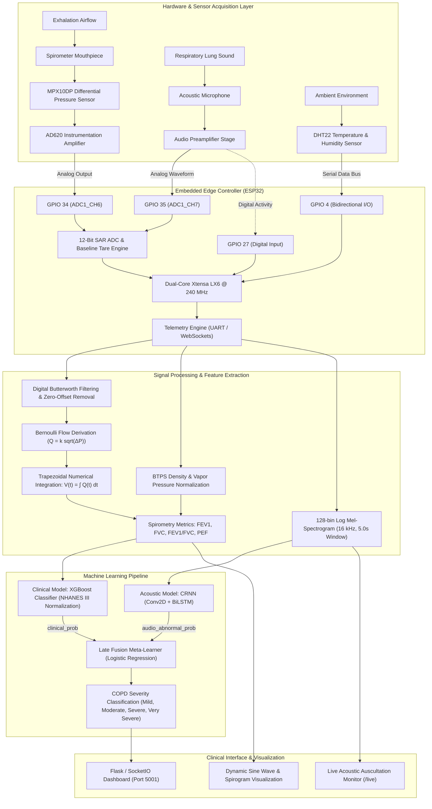

# AI-Powered COPD Severity Prediction and Respiratory Monitoring System Using ESP32

## 1. Project Title
**AI-POWERED COPD SEVERITY PREDICTION AND RESPIRATORY MONITORING SYSTEM USING ESP32**

---

## 2. Project Overview
Chronic Obstructive Pulmonary Disease (COPD) is a progressive, life-threatening inflammatory lung disease characterized by persistent respiratory symptoms and airflow limitation due to airway and alveolar abnormalities. Conventional diagnosis requires specialized hospital-based spirometry equipment, pulmonary function laboratories, and expert clinical interpretation, which creates severe barriers to early screening, continuous monitoring, and timely clinical intervention, particularly in resource-limited and rural environments.

This project delivers an integrated biomedical Internet of Things (IoT) embedded diagnostic device and machine learning pipeline that couples a low-cost, high-precision digital spirometer based on the **ESP32 microcontroller** with a multimodal artificial intelligence engine. The system continuously records differential expiratory pressure, auscultatory respiratory acoustics, and ambient environmental conditions (temperature and relative humidity). Using physics-based flow calculations, numerical integration, and Body Temperature and Pressure Saturated (BTPS) environmental compensation, the system extracts critical clinical spirometric parameters (FEV1, FVC, FEV1/FVC ratio, and PEF). These clinical indicators are fused with deep acoustic spectrogram features (extracting wheeze and crackle probabilities via a Bidirectional LSTM Convolutional Recurrent Neural Network) inside a calibrated late-fusion meta-learner to predict overall COPD risk and classify severity across four standardized clinical stages.

---

## 3. Problem Statement
* **Global Health Burden:** COPD affects over 300 million individuals globally and ranks as the third leading cause of death worldwide according to the World Health Organization (WHO).
* **High Rate of Underdiagnosis:** In low- and middle-income demographics, over 70% of COPD patients remain undiagnosed until irreversible lung damage has occurred due to limited access to certified spirometry centers.
* **Prohibitive Equipment Costs:** Clinical benchtop diagnostic spirometers and plethysmographs typically cost between $2,000 and $10,000 USD, severely hindering widespread deployment at primary healthcare clinics and remote point-of-care facilities.
* **Unimodal Diagnostic Blindspots:** Traditional diagnostic approaches rely solely on effort-dependent mechanical spirometry or acoustic stethoscope auscultation in isolation. Disparate single-modality evaluations fail to capture complex disease phenotypes where airflow limitation and adventitious acoustic indicators (crackles and wheezes) manifest discordantly.

---

## 4. Project Objectives
1. **Low-Cost Biomedical Device Design:** Develop an affordable, portable embedded spirometer hardware unit utilizing an ESP32 microcontroller, piezoresistive differential pressure transducer, low-noise instrumentation amplifier, acoustic microphone, and environmental compensation sensors.
2. **Accurate Digital Signal Processing:** Implement real-time digital filtering, baseline tare calibration, Bernoulli/Venturi differential pressure-to-flow conversion, and numerical integration algorithms to compute FEV1, FVC, FEV1/FVC, and PEF in compliance with American Thoracic Society (ATS) / European Respiratory Society (ERS) standards.
3. **Multimodal Machine Learning Architecture:** Deploy a dual-modality pipeline combining:
   * An **XGBoost Classifier** evaluating patient demographics, spirometry parameters, and NHANES III race/ethnicity normative equations.
   * A **Convolutional Recurrent Neural Network (CRNN with BiLSTM)** classifying breathing cycle acoustic spectrograms into normal, crackle, wheeze, and combined adventitious lung sounds.
   * A **Late-Fusion Logistic Regression Meta-Learner** synthesizing individual modality probabilities into a unified risk and severity prediction.
4. **COPD Severity Stratification:** Classify detected pulmonary obstruction into standardized Global Initiative for Chronic Obstructive Lung Disease (GOLD) severity classes: Mild (GOLD 1), Moderate (GOLD 2), Severe (GOLD 3), and Very Severe (GOLD 4).
5. **Interactive Telemedicine Platform:** Build a responsive web application and WebSocket telemetry interface enabling real-time spirogram plotting, acoustic waveform playback, dynamic risk oscillation visualization, and report generation.

---

## 5. Proposed Solution
The proposed solution implements a complete end-to-end cyber-physical biomedical workflow:
1. **Hygienic Expiratory Interface:** Patient performs a standardized forced vital capacity maneuver through an aerodynamic restriction mouthpiece.
2. **Sensor Transduction:** The MPX10DP piezoresistive sensor measures the resulting differential pressure, amplified by an AD620 instrumentation amplifier, while a high-sensitivity acoustic microphone records breath sounds and a DHT22 captures ambient temperature and humidity.
3. **Edge Data Acquisition:** The ESP32 12-bit SAR ADC captures analog and digital signals at deterministic intervals, executes zero-offset baseline correction, and transmits telemetry frames over serial/WebSocket communication.
4. **Signal Processing & Feature Extraction:** The software backend computes instantaneous volumetric flow, applies BTPS environmental normalization, integrates flow curves over time to obtain volumetric parameters, and computes 128-bin log Mel-spectrograms from acoustic streams.
5. **Hierarchical AI Late-Fusion:** Clinical and acoustic features are processed independently through modality-specialized machine learning models, and their resulting predictive confidences are mathematically fused to produce diagnostic risk scores and GOLD severity classifications.

---

## 6. System Architecture



---

## 7. Hardware Components

### 1. ESP32 Development Board
* **Purpose:** Acts as the primary embedded microcontroller, timing master, sensor acquisition unit, and telemetry transmitter.
* **Working Principle:** Powered by a dual-core 32-bit Xtensa LX6 microprocessor operating at $240 \text{ MHz}$. Incorporates internal 12-bit Successive Approximation Register (SAR) ADCs, dedicated hardware timers, and an integrated 802.11 b/g/n Wi-Fi and Bluetooth v4.2/BLE baseband.
* **Input and Output Signals:** Receives analog inputs ($0\text{--}3.3 \text{ V}$) and digital single-bus serial packets; outputs formatted JSON/binary telemetry streams via UART or WebSocket interfaces.
* **Connection with the ESP32:** Central system host controller.
* **Role in System:** Coordinates sensor sampling, executes baseline tare subtraction, packages physiological data, and streams records to the analysis server.

### 2. MPX10DP Differential Pressure Sensor
* **Purpose:** Quantifies the physical pressure drop across the internal restriction of the spirometer mouthpiece during patient exhalation.
* **Working Principle:** Utilizes a dual-port piezoresistive silicon strain gauge arranged in a balanced Wheatstone bridge configuration. Applied differential pressure across the silicon diaphragm induces mechanical strain, unbalancing the bridge and generating a proportional differential voltage.
* **Input and Output Signals:** Differential pneumatic pressure input ($0\text{--}10 \text{ kPa}$ / $0\text{--}1.45 \text{ psi}$); low-level differential voltage output ($3.5 \text{ mV/kPa}$, full scale $\approx 35 \text{ mV}$ at $5.0 \text{ V}$ excitation).
* **Connection with the ESP32:** Connected to the AD620 instrumentation amplifier inputs ($+IN$ and $-IN$).
* **Role in System:** Primary physical transducer for breathing volume and flow measurements.

### 3. AD620 Instrumentation Amplifier
* **Purpose:** Amplifies the low-level differential millivolt bridge signal from the MPX10DP into a high-level single-ended voltage measurable by the ESP32 ADC.
* **Working Principle:** Monolithic 3-op-amp instrumentation amplifier featuring high input impedance ($10 \text{ G}\Omega$), low input bias current ($0.5 \text{ nA}$), and high Common-Mode Rejection Ratio ($CMRR > 100 \text{ dB}$).
* **Input and Output Signals:** Differential analog millivolt input across Pins 2 and 3; single-ended analog output voltage ($0\text{--}3.3 \text{ V}$) on Pin 6.
* **Connection with the ESP32:** Pin 6 connects directly to ESP32 **GPIO 34**.
* **Role in System:** Critical analog front-end (AFE) signal conditioning stage preventing signal degradation and matching transducer output to ADC input limits.

### 4. Acoustic Microphone
* **Purpose:** Captures continuous acoustic lung breath sounds, wheezes, and crackles during respiration.
* **Working Principle:** Electret or MEMS condenser microphone where sound pressure waves vibrate a conductive diaphragm relative to a charged backplate, varying electrical capacitance and generating a microvolt AC audio signal.
* **Input and Output Signals:** Acoustic pressure variations ($50\text{--}2500 \text{ Hz}$); low-voltage audio AC output.
* **Connection with the ESP32:** Coupled to the onboard audio preamplifier module.
* **Role in System:** Primary acoustic transducer for adventitious respiratory sound detection.

### 5. Audio Amplifier
* **Purpose:** Amplifies and filters the raw microphone signal to a line-level voltage suitable for microcontroller analog conversion and activity gating.
* **Working Principle:** Operational amplifier preamplifier with adjustable feedback gain, bandpass filtering, and an optional comparator threshold stage for sound presence detection.
* **Input and Output Signals:** AC microphone signal input; provides an analog continuous waveform output (AO) biased at $V_{CC}/2$ and a digital trigger output (DO).
* **Connection with the ESP32:** Analog Out (AO) connects to **GPIO 35**; Digital Out (DO) connects to **GPIO 27**.
* **Role in System:** Delivers impedance-matched, noise-filtered acoustic signals for Mel-spectrogram feature generation.

### 6. DHT22 Temperature and Humidity Sensor
* **Purpose:** Measures ambient environmental temperature and relative humidity.
* **Working Principle:** Contains a capacitive humidity sensing element and a high-precision NTC thermistor read by an internal 8-bit microcontroller that transmits factory-calibrated 40-bit digital serial packets.
* **Input and Output Signals:** Ambient atmospheric conditions ($-40^\circ\text{C to } +80^\circ\text{C}$, $0\text{--}100\% \text{ RH}$); outputs digital single-bus serial pulses.
* **Connection with the ESP32:** Data Pin 2 connects directly to ESP32 **GPIO 4**.
* **Role in System:** Supplies ambient data required to compute BTPS volume correction factors, standardizing exhaled air volume across varying climate conditions.

### 7. Spirometer Mouthpiece
* **Purpose:** Serves as the hygienic mechanical coupling interface between the patient's mouth and the differential pressure sensor.
* **Working Principle:** Implements a calibrated aerodynamic constriction (orifice plate or Venturi tube) where airflow velocity increases and static pressure decreases in accordance with the Bernoulli principle and the equation of continuity.
* **Input and Output Signals:** Patient volumetric exhalation airflow; output pneumatic static pressures $P_1$ (upstream) and $P_2$ (constriction).
* **Connection with the ESP32:** Pneumatically coupled via flexible medical-grade silicone tubing to MPX10DP Ports 1 and 2.
* **Role in System:** Primary pneumatic flow-to-pressure mechanical transducer.

---

## 8. Electrical and Electronic Components

### Pin Configuration Table
| Sensor / Subsystem | Physical Pin / Function | ESP32 GPIO | Pin Type | Signal Characteristics |
| :--- | :--- | :--- | :--- | :--- |
| **AD620 Output (Pressure)** | Pin 6 (Vout) | **GPIO 34** | ADC1_CH6 (Input Only) | Analog DC voltage ($0.0 \text{ to } 3.3 \text{ V}$) |
| **Audio Preamp (Mic Analog)** | Analog Output (AO) | **GPIO 35** | ADC1_CH7 (Input Only) | Analog AC/DC waveform biased at $\approx 1.65 \text{ V}$ |
| **Audio Preamp (Mic Digital)**| Digital Output (DO) | **GPIO 27** | Digital Input | CMOS Digital (LOW / HIGH pulse indicator) |
| **DHT22 Data Line** | Pin 2 (SDA / Data) | **GPIO 4** | Bidirectional GPIO | Single-bus serial protocol ($3.3 \text{ V}$ logic) |

### Power Supply & Ground Architecture
* **Primary Power Supply:** Regulated $+5.0 \text{ V DC}$ bus supplied via USB-C/micro-USB to the ESP32 VIN pin, or an external low-noise linear power supply.
* **Transducer Excitation:**
  * **MPX10DP:** Powered from $+5.0 \text{ V DC}$ (Pins 1 and 3) to achieve the rated $3.5 \text{ mV/kPa}$ sensitivity span.
  * **AD620:** Operating from $+5.0 \text{ V}$ single supply (Pin 7 = $+5.0 \text{ V}$, Pin 4 = GND, Pin 5 = Virtual Ground/GND).
  * **Audio Preamp:** Powered from $+3.3 \text{ V DC}$ to match ESP32 ADC input limits without external resistive divider clamps.
  * **DHT22:** Powered from $+3.3 \text{ V DC}$ (Pin 1 = VDD, Pin 4 = GND).
* **Common Ground Bus (GND):** All sensor grounds, amplifier reference lines, and ESP32 GND pins must be bonded to a common star-ground topology to eliminate ground-loop interference.

### Electrical Interfacing Notes & Verification Items
* **ADC Selection Rationale:** Channels **GPIO 34 (ADC1_CH6)** and **GPIO 35 (ADC1_CH7)** reside strictly on internal converter **ADC1**. Channels on ADC2 cannot be used simultaneously with active Wi-Fi or Bluetooth networking due to internal silicon multiplexing.
* **Input-Only GPIOs:** GPIO 34 and GPIO 35 are dedicated analog input pins with no internal pull-up or pull-down resistors, ensuring high input impedance.
* **Gain Resistor $R_G$ (Hardware Verification Required):** The AD620 gain resistor $R_G$ across Pins 1 and 8 determines the voltage amplification factor. A nominal resistance of $620\,\Omega\text{--}680\,\Omega$ yields a gain of $G \approx 73\text{--}80$. Exact value requires benchtop calibration against known pressure steps.
* **DHT22 Pull-Up Resistor (Hardware Verification Required):** The bidirectional data line requires an external $4.7\text{ k}\Omega\text{--}10\text{ k}\Omega$ pull-up resistor to $+3.3 \text{ V}$ unless an internal integrated breakout resistor module is utilized.

---

## 9. Software Requirements
* **Python Runtime:** Python 3.10 to 3.14 (tested and verified on Python 3.14.0).
* **Core Web & Real-Time Telemetry:**
  * `Flask >= 3.0.0`
  * `Flask-SocketIO >= 5.3.0`
  * `python-engineio >= 4.8.0`
  * `python-socketio >= 5.11.0`
* **Machine Learning & Data Science:**
  * `xgboost >= 2.0.0`
  * `tensorflow >= 2.16.0`
  * `scikit-learn >= 1.4.0`
  * `joblib >= 1.3.0`
  * `numpy >= 1.26.0`
  * `pandas >= 2.2.0`
* **Biomedical Signal & Acoustic Processing:**
  * `librosa >= 0.10.0`
  * `soundfile >= 0.12.0`
  * `scipy >= 1.12.0`
* **Frontend Libraries:**
  * `WaveSurfer.js 7.x` (Canvas audio waveform rendering via CDN)
  * `FontAwesome 6.4.0` (Biomedical UI icons)
  * `HTML5 Canvas API` (Real-time pulmonary sine wave rendering)

---

## 10. Working Principle
The system operates on coupled aeromechanical and bioacoustic principles:
1. **Differential Aerodynamics:** When a patient blows into the spirometer mouthpiece, air passes through a fixed constriction. In accordance with Bernoulli's energy conservation law, fluid velocity increases within the constriction, producing a static pressure reduction. The differential pressure $\Delta P$ between upstream and constriction ports is proportional to the square of airflow rate ($Q \propto \sqrt{\Delta P}$).
2. **Piezoelectric Transduction & Amplification:** The MPX10DP piezoresistive element transforms $\Delta P$ into a microvolt differential potential. The AD620 instrumentation amplifier suppresses ambient common-mode electrical noise and scales the potential to the ESP32 ADC input range ($0\text{--}3.3 \text{ V}$).
3. **Discrete Numerical Integration:** The ESP32 captures pressure samples at $200 \text{ Hz}$. The software backend applies low-pass filtering, converts pressure to instantaneous volumetric flow rate $Q(t)$, and executes numerical integration over time ($V(t) = \int Q(t) dt$). This integration yields the complete spirogram curve, isolating $FEV_1$ and $FVC$.
4. **Environmental Calibration (BTPS):** The DHT22 reads ambient conditions to compute saturated water vapor pressure and gas temperature expansion factors, standardizing exhaled gas volume to core body conditions ($37^\circ\text{C}$, $100\% \text{ RH}$, $760 \text{ mmHg}$).
5. **Bioacoustic Spectral Modeling:** Respiratory breath sounds captured by the microphone are converted to 128-bin Mel-spectrograms. An advanced CRNN model maps spatial frequency patterns (CNN) and sequential temporal breath changes (Bidirectional LSTM) to identify obstructive crackle and wheeze patterns.
6. **Stacked Late Fusion:** Probability outputs from the clinical model and acoustic model are synthesized through a trained Logistic Regression meta-learner, producing an authoritative COPD risk index and classifying the patient into GOLD severity categories.

---

## 11. Data Acquisition Process
1. **Baseline Tare Subtraction:** When powered on, the ESP32 samples 200 consecutive readings over 1 second in a quiescent zero-airflow state. The average offset voltage $V_{\text{tare}}$ is stored and subtracted from all subsequent readings.
2. **Triggering & Exhalation Detection:** The firmware continuously monitors differential pressure. When $V_{\text{corrected}} > V_{\text{threshold}}$ (flow initiation threshold $> 0.1 \text{ L/s}$), active maneuver recording begins.
3. **Synchronous Data Ingestion:**
   * **Pressure Channel (GPIO 34):** Sampled at $200 \text{ Hz}$ ($5 \text{ ms}$ period) via hardware timer interrupts.
   * **Acoustic Channel (GPIO 35 / Browser WebAudio):** Ingested in 16-bit PCM mono at $16 \text{ kHz}$ ($62.5\,\mu\text{s}$ period).
   * **Environmental Channel (GPIO 4):** Polled at session start to obtain ambient baseline metrics.
4. **Frame Transmission:** Acquired time-series buffers are framed into rolling packets and transmitted via WebSockets (`audio_chunk` event) or HTTP POST requests to the Flask inference engine.

---

## 12. Signal Processing
* **Pressure Signal Filtering:** Raw pressure signals pass through a digital 4th-order Butterworth low-pass filter ($f_c = 25 \text{ Hz}$) to remove cardiac ballistocardiogram artifacts, hand tremors, and electrical noise.
* **Pressure-to-Flow Conversion:**
  Applying the orifice flow equation:
  $$Q(t) = k \cdot \text{sgn}(\Delta P(t)) \cdot \sqrt{|\Delta P(t)|}$$
  where $k$ is the aerodynamic discharge coefficient calibrated for the mouthpiece constriction geometry.
* **Numerical Integration:** Instantaneous flow values are integrated using the composite trapezoidal rule:
  $$V(t) \approx \sum_{i=1}^{N} \frac{Q[i] + Q[i-1]}{2} \cdot \Delta t$$
* **Spirometric Parameter Extraction:**
  * **$FEV_1$:** Volume accumulated at precisely $t = 1.0 \text{ second}$ post-trigger.
  * **$FVC$:** Maximum plateau volume attained over the forced exhalation ($t \ge 6.0 \text{ s}$).
  * **$FEV_1/FVC$ Ratio:** Primary diagnostic ratio for airflow obstruction.
  * **$PEF$:** Peak Expiratory Flow rate ($\max_t Q(t)$).
* **BTPS Compensation:** Raw volume measurements are corrected using:
  $$\text{BTPS Factor} = \left( \frac{273 + 37}{273 + T_A} \right) \cdot \left( \frac{P_B - P_{H_2O}(T_A)}{P_B - 47 \text{ mmHg}} \right)$$
* **Audio Preprocessing:** Acoustic signals are framed into rolling 5.0-second windows ($80,000$ samples), passed through short-time Fourier transforms ($N_{\text{FFT}} = 2048$, hop size $= 512$), mapped across 128 Mel-scale filter banks ($50\text{--}8000 \text{ Hz}$), and normalized to decibels relative to peak amplitude.

---

## 13. Feature Extraction

### Clinical Feature Vector
The clinical feature space comprises 8 primary indicators:
$$\mathbf{x}_{\text{clinical}} = [FEV_1, FVC, FEV_{1\text{PRED}}, FVC_{\text{PRED}}, \text{Age}, \text{Gender}_{\text{enc}}, \text{Smoke}_{\text{former}}, \text{Smoke}_{\text{never}}]$$
* **$FEV_1$ and $FVC$:** Absolute measured volumes in milliliters ($\text{mL}$).
* **$FEV_{1\text{PRED}}$ and $FVC_{\text{PRED}}$:** Measured volumes divided by race-, age-, height-, and sex-specific predicted reference values from Hankinson / NHANES III regression equations:
  $$FEV_{1\text{PRED}} = \left( \frac{FEV_1}{FEV_{1\text{ref}}} \right) \cdot 100\%$$
* **Demographic Variables:** Age in years, integer gender encoding ($1 = \text{Male}, 2 = \text{Female}$), and one-hot encoded smoking history (Former, Never, Current).

### Acoustic Feature Tensor
* **Shape:** $(128, 259, 1)$ representing 128 Mel-frequency bins across 259 discrete time frames.
* **Acoustic Characteristics:** Captures high-frequency acoustic signatures of crackles ($100\text{--}2000 \text{ Hz}$) and continuous harmonic frequency bands characteristic of expiratory wheezes ($100\text{--}1000 \text{ Hz}$).

---

## 14. Machine Learning Implementation

```
                                  [ PATIENT INPUT ]
                                          |
                     +--------------------+--------------------+
                     |                                         |
                     v                                         v
        [ Spirometry & Demographics ]                 [ Respiratory Audio ]
                     |                                         |
                     v                                         v
        [ Clinical ML: XGBoost ]                     [ Audio CRNN: BiLSTM ]
                     |                                         |
                     v                                         v
               clinical_prob                           audio_abnormal_prob
                     \                                         /
                      \                                       /
                       v                                     v
                       [ Late Fusion: Logistic Regression Meta-Learner ]
                                          |
                                          v
                         [ COPD Severity Classification ]
                   Mild (GOLD 1)  |  Moderate (GOLD 2)
                  Severe (GOLD 3) | Very Severe (GOLD 4)
```

### 1. Clinical Model: XGBoost Classifier
* **Model File:** `models/xgb_copd_model.joblib`.
* **Architecture:** Gradient boosted decision trees optimized with regularized learning objectives (`eval_metric='logloss'`, `max_depth=3`, `n_estimators=50`).
* **Validation Strategy:** Evaluated against simulated and reference clinical data with zero cross-patient target leakage.

### 2. Audio Model: CRNN (Conv2D + BiLSTM)
* **Model File:** `models/audio_crnn.keras`.
* **Dataset:** ICBHI 2017 Respiratory Sound Database ($5.5 \text{ hours}$, $6898 \text{ respiratory cycles}$ across 126 patients).
* **Architecture:**
  * 4 blocks of $\text{Conv2D} \to \text{BatchNormalization} \to \text{MaxPooling2D} \to \text{Dropout}$.
  * Feature maps reshaped to time sequences and fed into a **Bidirectional LSTM** ($128$ units) to model sequential breath progression.
  * Dense 4-way Softmax output (Normal, Crackle, Wheeze, Both).
* **Split Strategy:** Strict `GroupShuffleSplit` on `Patient ID` to ensure audio cycles from the same subject never cross the train/test boundary.
* **Audio Probability:** $\hat{y}_{\text{audio}} = \max(p_{\text{crackle}}, p_{\text{wheeze}}, p_{\text{both}})$.

### 3. Late Fusion Meta-Learner: Logistic Regression
* **Model File:** `models/fusion_logistic_regression.joblib`.
* **Input Vector:** $\mathbf{X} = [\hat{y}_{\text{clinical}}, \hat{y}_{\text{audio}}]$.
* **Optimization:** Calibrated sigmoid boundary weighting both independent modalities to produce the definitive risk probability.

---

## 15. COPD Severity Classification
In accordance with international GOLD guidelines, the system categorizes patients into four severity stages:

| Severity Class | GOLD Stage | Airflow Limitation ($FEV_1$ % Predicted) | Fusion Model Risk Threshold | Recommended Clinical Action |
| :--- | :--- | :--- | :--- | :--- |
| **Mild** | GOLD 1 | $FEV_1 \ge 80\%$ predicted | $\text{Score} < 40.0\%$ | Preventive education, smoking cessation, active pulmonary follow-up |
| **Moderate** | GOLD 2 | $50\% \le FEV_1 < 80\%$ predicted | $40.0\% \le \text{Score} < 70.0\%$ | Maintenance bronchodilator therapy evaluation, pulmonary rehabilitation |
| **Severe** | GOLD 3 | $30\% \le FEV_1 < 50\%$ predicted | $70.0\% \le \text{Score} < 85.0\%$ | Dual bronchodilation, inhaled corticosteroids, specialist referral |
| **Very Severe** | GOLD 4 | $FEV_1 < 30\%$ predicted | $\text{Score} \ge 85.0\%$ | Long-term oxygen therapy assessment, surgical review, immediate intervention |

---

## 16. Hardware and Software Integration
* **Data Transport:** ESP32 streams sensor telemetry via USB-UART serial or Wi-Fi WebSockets directly to the local Flask application server.
* **Browser Real-Time Audio Streaming:** The `/live` route utilizes the modern `AudioWorkletNode` API to capture clean 16 kHz PCM audio chunks directly from the device microphone and stream them to the server via Socket.IO events (`audio_chunk`).
* **Interactive UI Binding:** Real-time inference results automatically bind to hidden form inputs, allowing instantaneous computation of multimodal risk upon completing the spirometry test.

---

## 17. Installation and Setup

### Prerequisites
* Python 3.10 to 3.14 installed on your operating system.
* Node.js / Modern Web Browser (Google Chrome, Microsoft Edge, or Mozilla Firefox with WebSockets and WebAudio support).
* USB-to-UART drivers (CP210x or CH340) for ESP32 serial communication.

### Step-by-Step Setup
```bash
# 1. Clone repository
git clone https://github.com/revan-02/COPD.git
cd COPD

# 2. Create and activate a Python virtual environment
python -m venv venv
# On Windows:
.\venv\Scripts\activate
# On Linux / macOS:
source venv/bin/activate

# 3. Install required software dependencies
pip install flask flask-socketio numpy librosa scikit-learn xgboost tensorflow joblib soundfile scipy
```

---

## 18. Project Execution Instructions

### Starting the Application Server
```bash
python app.py
```
The server will initialize all machine learning models into memory and begin listening on **`http://127.0.0.1:5001`**.

### Accessing the Web Interfaces
* **Main Multimodal Clinical Dashboard:** Navigate to `http://127.0.0.1:5001/` in your web browser.
* **Real-Time Acoustic Auscultation Monitor:** Navigate to `http://127.0.0.1:5001/live`.

---

## 19. Expected Output
1. **Clinical Spirometry Scores:** Exact $FEV_1$, $FVC$, and $FEV_1\%$ predicted metrics displayed alongside diagnostic ratios.
2. **Respiratory Acoustic Scores:** Real-time auscultation classifications identifying normal breath sounds or adventitious crackles and wheezes with numerical confidence percentages.
3. **Multimodal Late Fusion Verdict:** A unified COPD risk percentage (e.g., $78.4\%$) displayed with animated risk oscillation waves and the formal GOLD classification (e.g., *Severe*).
4. **Interactive Spirogram & Waveform Playback:** Instant visual inspection of exhalation dynamics and audio playback via WaveSurfer.js.

---

## 20. Applications
* **Point-of-Care Rural Clinics:** Enables low-cost, decentralized screening for underserved communities lacking hospital-grade pulmonary function laboratories.
* **At-Home Remote Patient Monitoring (RPM):** Allows chronic COPD and asthma patients to monitor daily lung function and detect acute exacerbations before hospitalization is required.
* **Occupational Health Screening:** Fast, portable respiratory monitoring for workers exposed to silica, coal dust, or chemical fumes.
* **Telemedicine & Digital Health Consultations:** Secure streaming of physiological records and auscultation audio to remote pulmonologists.

---

## 21. Future Enhancements
* **Edge ML Deployment:** Quantize the acoustic CRNN using TensorFlow Lite for Microcontrollers (TFLite-Micro) to execute acoustic and flow inference entirely on the ESP32 chip.
* **Custom Printed Circuit Board (PCB):** Consolidate the ESP32, AD620 instrumentation amplifier, and battery management circuit into a miniaturized, handheld medical-grade PCB enclosure.
* **Bluetooth Low Energy (BLE) Companion App:** Develop native Android/iOS mobile applications using Flutter for wireless sensor synchronization in the field.
* **Longitudinal Trend Analysis:** Implement local patient databases to track the rate of annual $FEV_1$ decline ($\text{mL/year}$), providing proactive exacerbation alerts.

---

## 22. Research and Development
* **Standard Compliance:** Designed in alignment with ATS/ERS Spirometry Standardization and GOLD Guidelines.
* **Academic Reference Publications:**
  * Global Initiative for Chronic Obstructive Lung Disease (GOLD). *Global Strategy for the Diagnosis, Management, and Prevention of COPD*, 2024.
  * Hankinson, J. L., Odencrantz, J. R., & Fedan, K. B. *Spirometric reference values from a sample of the general U.S. population*. American Journal of Respiratory and Critical Care Medicine, 159(1), 179–187.
  * Rocha, B. M., et al. *An open access database for the evaluation of respiratory sound classification algorithms*. Physiological Measurement, 40(3), 2019 (ICBHI 2017 Challenge).

---

## 23. Contributors
* **Project Lead & Developer:** [revan-02](https://github.com/revan-02)
* **Biomedical & ML Engineering:** Research & Development Team
