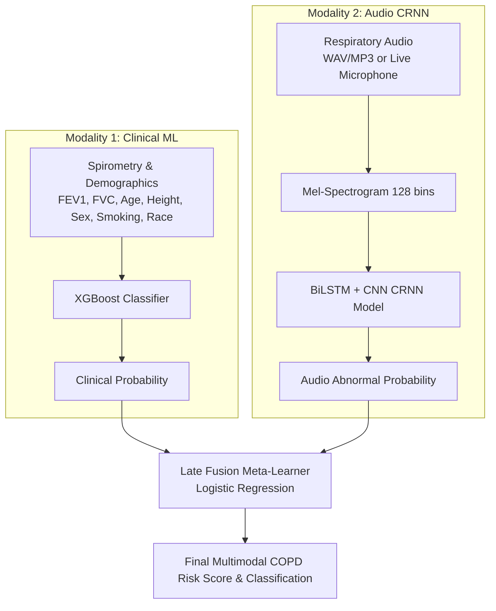

# COPD: Multimodal Risk Screening & Respiratory Monitoring

> AI-powered COPD detection and severity prediction using machine learning, spirometry data, and an ESP32-based low-cost respiratory monitoring system.

PulmoAI is a multimodal machine learning system designed to evaluate COPD risk by combining **Clinical Spirometry Data** and **Respiratory Audio Acoustics** using a late-fusion meta-learner.

---

## 🏗️ Architecture



---

## 📁 Project Structure

```
copd app/
├── app.py                      # Flask & SocketIO application server
├── DATASET_SETUP.md            # Dataset preparation guidelines
├── ML_AUDIT_REPORT.md          # Machine learning & data leakage audit
├── README.md                   # Project overview & documentation
├── inference/
│   ├── clinical_inference.py   # Clinical XGBoost inference pipeline
│   ├── audio_inference.py      # Audio CRNN inference pipeline
│   └── fusion_inference.py     # 2-modality Late Fusion inference
├── models/
│   ├── xgb_copd_model.joblib   # Pre-trained Clinical XGBoost model
│   ├── audio_crnn.keras        # Pre-trained Audio BiLSTM-CNN model
│   └── fusion_logistic_regression.joblib # 2-Feature Fusion model
├── templates/
│   ├── index.html              # Main multimodal risk dashboard
│   └── live_audio.html         # Live acoustic monitoring interface
├── training/
│   ├── train_audio.py          # Audio CRNN training script
│   └── train_fusion_no_xray.py # 2-feature Late Fusion training script
└── uploads/                    # Upload directory for audio samples
```

---

## 🚀 Running the Application

### 1. Install Dependencies
```bash
pip install flask flask-socketio numpy librosa scikit-learn xgboost tensorflow joblib
```

### 2. Start the Server
```bash
python app.py
```
The server will start on: **`http://127.0.0.1:5001`**

---

## 🔍 Features & Modalities

1. **Clinical Spirometry (XGBoost):**
   - Inputs: FEV1, FVC, Age, Height, Gender, Smoking Status, Race Reference Equations.
   - Outputs: COPD probability derived from clinical airflow obstruction patterns.

2. **Respiratory Acoustics (BiLSTM-CNN):**
   - Inputs: Recorded audio files (.wav, .mp3) or live microphone streaming via WebSockets.
   - Classifies: Normal breathing, Crackles, Wheezes, or Crackle+Wheeze combination.

3. **Late Fusion Meta-Learner:**
   - Evaluates a calibrated decision boundary across `[clinical_prob, audio_prob]`.
   - Classifies risk into **Low (<40%)**, **Moderate (40–70%)**, or **High (≥70%)** risk categories.
